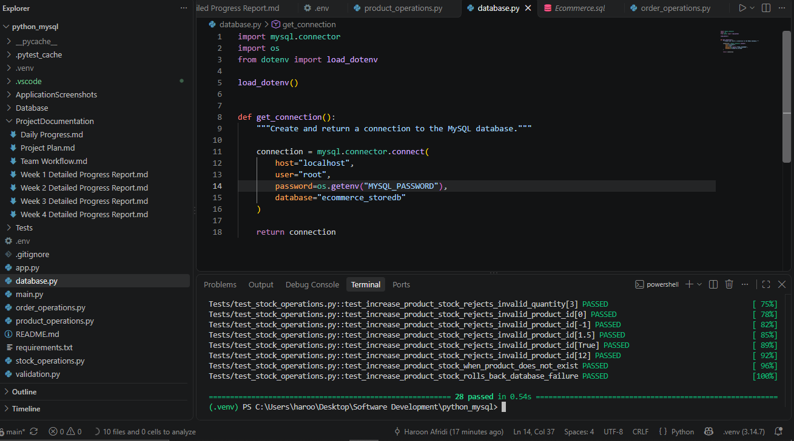

# Software Development – Week 4 Progress Report

**Group Members:**
1. Haroon Afridi
2. Pradeep Sapkota
3. Poshan Oli
4. Lamyae Echaoui

**Week:** Week 4  
**Topic:** Reliable Applications 

(Validation, Exceptions, Transactions and Error Messages)

---

### 1. Introduction

During Week 4, the team continued developing the Online Store Management System using Python, Streamlit and MySQL.

The main focus was improving the application structure, implementing input validation, handling errors, managing database transactions and testing the main application features.

### 2. Work Completed

**2.1 Input Validation**

- Created `validation.py` to handle input validation separately from the application interface.
- Added validation rules to prevent invalid product, order and stock information.
- Used `ValueError` to report invalid user input.
- Improved data checking before database operations.

**2.2 Product Management**

- Updated the product management module.
- Improved product operations and input handling.
- Added and reviewed automated tests for product operations.

**2.3 Stock Management**

- Developed `stock_operations.py`.
- Implemented functionality to increase the stock quantity of existing products.
- Added validation for product IDs and stock quantities.
- Added tests for valid and invalid stock operations.

**2.4 Order Management**

- Updated `order_operations.py`.
- Improved order creation and status management.
- Added transaction handling to maintain database consistency.
- Used commit and rollback where necessary.
- Improved handling of errors during order operations.

**2.5 Database Connection and Error Handling**

- Updated `database.py` to use environment variables for the MySQL password.
- Used the `python-dotenv` package to load database credentials from the local `.env` file.
- Improved database error handling and logging.
- Kept database credentials separate from the source code.

### 3. Testing

Automated tests were executed using Pytest.

Command:

```bash
python -m pytest -v
```

**Test result: 28 passed**



The tests covered:

- Product operations
- Order operations
- Stock management
- Input validation
- Invalid input handling
- Database errors and transaction rollback

Manual application testing was also performed to check the main features.

### 4. Project Documentation

The project README was prepared and updated with:

- Project overview and main features
- Technologies used
- Project folder structure
- Installation and database setup instructions
- Application execution instructions
- Testing instructions
- Team member information

The project documentation folder was also maintained with the previous weekly progress reports and project plan.

### 5. GitHub Updates

The latest application and documentation changes were committed and pushed to the team's GitHub repository.

The update included:

- Updated README
- Updated application and database modules
- Updated product and order modules
- New stock management module
- New validation module
- Updated automated test files

The changes were successfully pushed to the `main` branch after synchronising the local branch with the remote repository.

**GitHub repository:**

https://github.com/pradeepsapkota-dot/Online-store_Software_developing-

### 6. Challenges and Solutions

| Challenge | Solution |
|---|---|
| Invalid input could reach database operations | Added reusable validation functions |
| Database operations could fail during processing | Improved exception handling and rollback |
| Stock quantities needed additional checks | Added validation and automated stock tests |
| Database credentials should not be exposed | Used a local `.env` file |
| GitHub rejected the initial push | Used `git pull --rebase` before pushing again |

### 7. Current Project Status

By the end of Week 4:

- Product management functionality was updated.
- Order management functionality was improved.
- Stock management functionality was implemented.
- Input validation and error handling were improved.
- Automated tests passed successfully (28 tests).
- README documentation was prepared.
- Latest changes were uploaded to GitHub.

### 8. Work Planned for Week 5

The next development stage will focus on:

- Further integration of the main application features.
- Improving the Streamlit user interface.
- Reviewing the application workflow.
- Checking that all modules work together correctly.
- Continuing testing and fixing any remaining issues.

### 9. Conclusion

During Week 4, significant progress was made in improving the reliability and functionality of the Online Store Management System. Input validation, error handling, database transactions and stock management were developed or improved. The automated tests passed successfully, and the latest application changes and README were uploaded to GitHub.

The project is ready to continue with further application integration and user interface improvements in Week 5.